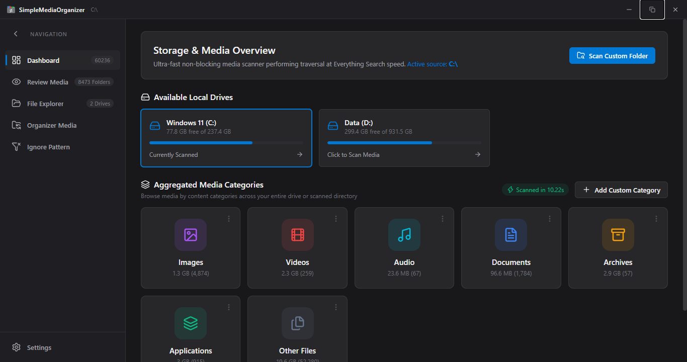
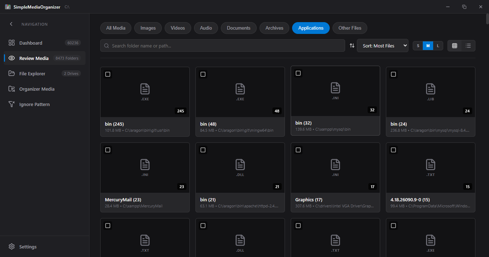
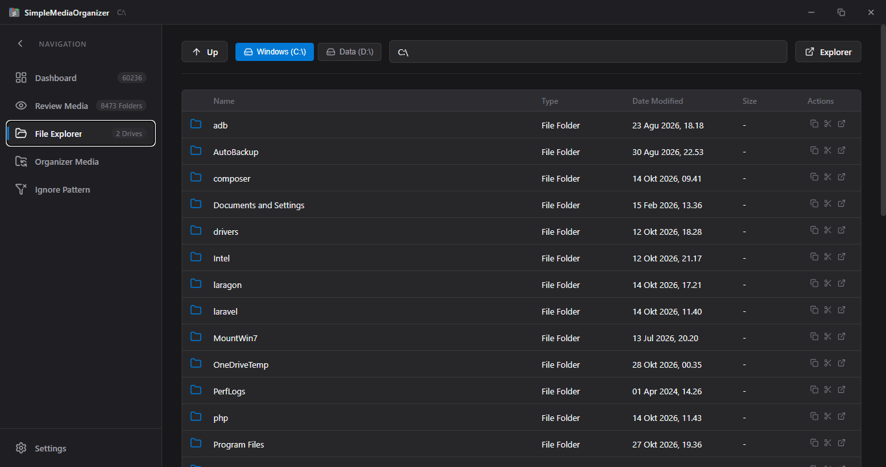
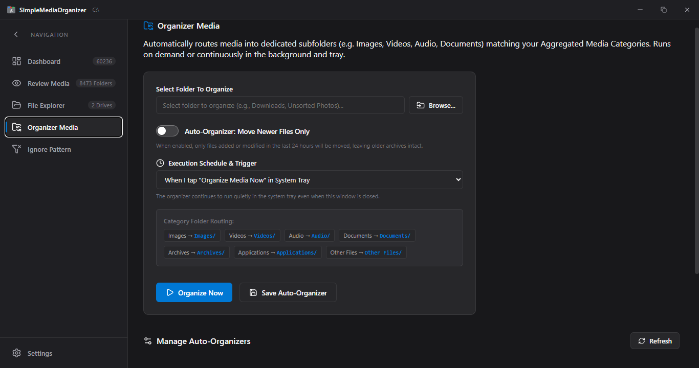
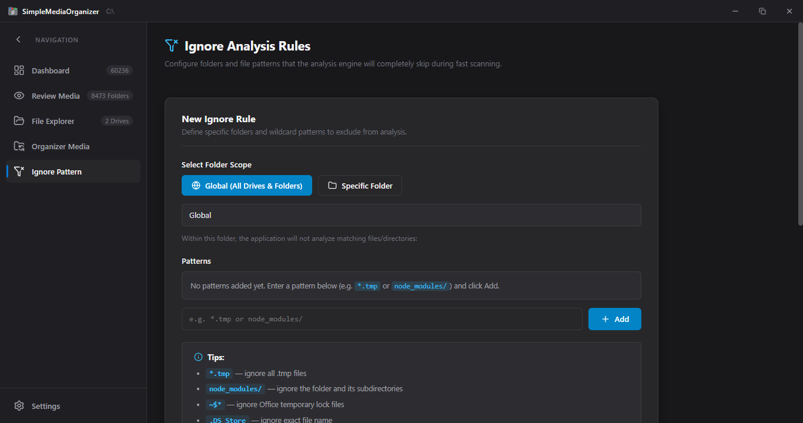

<div align="center">


# SimpleMediaOrganizer

**High-Performance Windows Media Organizer & Native File Explorer**  
*Built with Rust (Tauri v2) + React 19 • Windows 11 Fluent Design • Windows 10 & 11 (x64)*

<br />

[](https://apps.microsoft.com/store/detail/9PFL59JPQ29P?cid=DevShareMCLPCS)

<br />

[](https://microsoft.com/windows)
[](LICENSE)
[](https://www.rust-lang.org/)
[](https://tauri.app/)
[](https://react.dev/)
[](https://github.com/nimidz/SimpleMediaOrganizer/releases)

<br />

<!-- Developer Support Badges -->
[](https://trakteer.id/nimidz)
&nbsp;
[](https://ko-fi.com/nimidz)

<br />

[Features](#-features) • [Screenshots](#-screenshots) • [Download](#-download--installation) • [Shortcuts](#-keyboard-shortcuts) • [Tech Stack](#-tech-stack) • [Development](#-development-setup) • [License](#-license)

---

</div>

## 📖 Overview

**SimpleMediaOrganizer** is a native desktop media organizer and file manager engineered for Windows 10 and Windows 11. Built with a multi-threaded Rust core (Tauri v2) and a responsive React 19 interface, it scans hundreds of thousands of files across internal and external storage drives with low memory and CPU overhead.

Whether cataloging photo collections, decluttering Downloads folders, inspecting disk storage, or setting up scheduled background sorting from the system tray, SimpleMediaOrganizer delivers direct Windows integration with shell-cached thumbnails, native clipboard support, and Explorer drag-and-drop.

---

## ⚡ Features

### 🚀 High-Speed Multi-Threaded Scanner
- Breadth-First Search (BFS) directory traversal written in Rust.
- Uses native Win32 `WIN32_FIND_DATAW` cached metadata to bypass disk syscall bottlenecks.
- Non-blocking asynchronous streaming reports progress in real time without freezing the UI.
- Classifies files into standard types (Images, Videos, Audio, Documents, Archives, Applications) and custom user-defined categories.

### 🖼️ Hardware-Accelerated Shell Thumbnails
- Directly interfaces with Windows Shell via `IShellItemImageFactory`.
- Renders high-resolution thumbnails for RAW photos, videos, executables, and media directly from Windows Explorer's shell cache.
- In-memory virtualized list caching keeps browsing fast and responsive.

### 📂 Native Windows Explorer Integration
- **True Drag & Drop**: Drag files and folders directly from the app window into Windows Explorer, desktop folders, or third-party applications.
- **Windows Clipboard**: Supports standard `Ctrl+C` (Copy) and `Ctrl+X` (Cut) compatible with Windows Explorer `Ctrl+V`.
- **Recycle Bin Protection**: Safe file and folder deletion sends items directly to the Windows Recycle Bin with undo support.
- **Spacebar Quick Look**: Instant preview lightbox for images, videos, audio, and documents.

### 🤖 Background Organizer & System Tray
- Runs quietly in the Windows background and system tray.
- Automatically organizes unmanaged folders into clean category subdirectories (`/Images`, `/Videos`, `/Documents`, `/Audio`, `/Archives`, etc.).
- Flexible trigger modes: run on-demand or schedule periodic runs (every 30m, 1h, 6h, 24h).
- Optional "Move Newer Files Only" mode to leave historical archives intact.

### 🚫 Custom Ignore & Exclusion Rules
- Exclude specific folders, build directories, or file extensions globally or per drive.
- Full wildcard pattern matching (e.g. `node_modules/`, `*.tmp`, `~$*`, `.git/`).

### ⚙️ Windows Startup Integration
- Optional launch on Windows boot via `HKCU\Software\Microsoft\Windows\CurrentVersion\Run`.
- Synchronized with Windows Task Manager Startup Apps for clean user control.

---

## 📸 Screenshots

### 1. Storage & Media Overview (Dashboard)
Scan entire drives or custom folders with immediate visual breakdown of storage usage and categorized media counts.


### 2. Review Media & Category Filtering
Filter media by category, search by path, and browse aggregated folders sorted by file count or size.


### 3. Native File Explorer
Fast directory navigation with direct drive switching, path breadcrumbs, file actions, and drag-and-drop.


### 4. Background Organizer & Automation
Configure directory routing rules and background schedules with system tray controls.


### 5. Ignore Analysis Rules
Set global or directory-specific wildcard patterns to skip unnecessary files during scans.


---

## 📥 Download & Installation

SimpleMediaOrganizer is available in two official distribution packages for Windows 10/11 (x64):

| Package | Description | Link |
| :--- | :--- | :--- |
| **Microsoft Store (`.msix`)** | Verified Windows package with sandboxed security and automated updates. | [**Get from Microsoft Store**](https://apps.microsoft.com/store/detail/9PFL59JPQ29P?cid=DevShareMCLPCS) |
| **Portable Standalone (`.exe`)** | Zero-install executable. Runs immediately from any local folder or USB drive. | [**Download Latest Release**](https://github.com/nimidz/SimpleMediaOrganizer/releases/latest) |

<div align="center">

[](https://apps.microsoft.com/store/detail/9PFL59JPQ29P?cid=DevShareMCLPCS)

</div>

---

## ⌨️ Keyboard Shortcuts

| Shortcut | Action | Scope |
| :--- | :--- | :--- |
| `Space` | Open / Close Quick Look preview lightbox | Media items & Explorer |
| `Ctrl + C` | Copy selected item to Windows clipboard | Explorer & Media lists |
| `Ctrl + X` | Cut selected item to Windows clipboard | Explorer & Media lists |
| `Ctrl + V` | Paste clipboard items into target folder | Explorer |
| `F2` | Rename selected file or folder inline | Explorer |
| `Delete` | Safely move selected file/folder to Windows Recycle Bin | Everywhere |
| `Enter` | Open directory or launch file in default system application | Explorer |
| `Esc` | Close modals, preview lightbox, or clear selection | Everywhere |

---

## 🛠️ Tech Stack

| Layer | Technology | Details |
| :--- | :--- | :--- |
| **Backend & System** | [Rust 2021](https://www.rust-lang.org/) | Win32 API, multi-threaded BFS scanner, IShellItemImageFactory, clipboard bridge |
| **Desktop Runtime** | [Tauri v2](https://tauri.app/) | Low memory footprint, native Windows Webview2 wrapper |
| **Frontend UI** | [React 19](https://react.dev/) + [Vite](https://vitejs.dev/) | React hooks, virtualized rendering, custom theme state |
| **Design System** | Vanilla CSS | Windows 11 Fluent Acrylic / Mica aesthetic, dark mode support |
| **Icons** | [Lucide React](https://lucide.dev/) | Consistent modern interface iconography |

---

## 💻 Development Setup

To run or build SimpleMediaOrganizer from source:

### Prerequisites
- [Node.js](https://nodejs.org/) (v18 or higher)
- [Rust toolchain](https://rustup.rs/) (stable channel, 2021 edition)
- Visual Studio C++ Build Tools with Windows 10/11 SDK

### 1. Clone the Repository
```bash
git clone https://github.com/nimidz/SimpleMediaOrganizer.git
cd SimpleMediaOrganizer
```

### 2. Install Node Dependencies
```bash
npm install
```

### 3. Run in Development Mode
```bash
npm run tauri:dev
```

### 4. Build Production Packages
```bash
# Build React web bundle
npm run build

# Build Tauri Windows binary (.exe / .msix)
npm run tauri:build
```

Compiled release binaries will be generated under `release-tauri/` or `src-tauri/target/release/bundle/`.

---

## ☕ Support the Developer

If SimpleMediaOrganizer helps keep your PC tidy and organized, you can support ongoing maintenance and feature development:

- **Trakteer**: [trakteer.id/nimidz](https://trakteer.id/nimidz)
- **Ko-Fi**: [ko-fi.com/nimidz](https://ko-fi.com/nimidz)

---

## 📄 License

This project is licensed under the **[GNU Affero General Public License v3.0 (AGPL-3.0)](LICENSE)**.

```
SimpleMediaOrganizer — High-Performance Windows Media Organizer
Copyright (C) 2026 nimidz

This program is free software: you can redistribute it and/or modify
it under the terms of the GNU Affero General Public License as published by
the Free Software Foundation, either version 3 of the License, or
(at your option) any later version.
```
